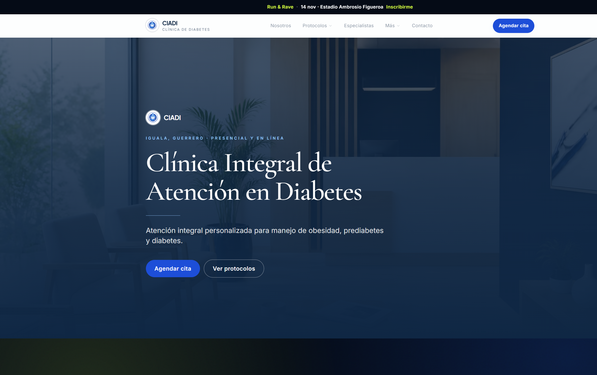
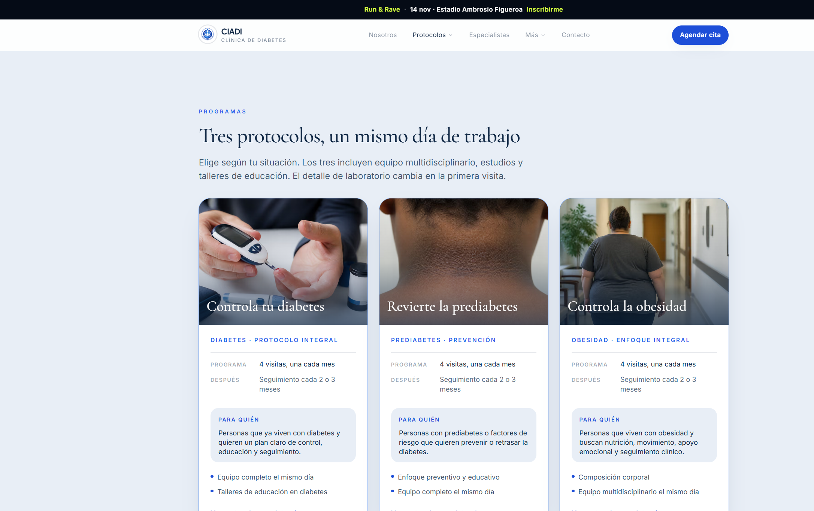

  

  
  
  
  
  

Estudiante de **Ingeniería en Desarrollo y Gestión de Software** en la Universidad Tecnológica de la Región Norte de Guerrero. Desarrollo aplicaciones web que se usan de verdad: expediente clínico, sitio institucional y sistemas de gestión.

---

## Trabajo destacado · CIADI

Sistema y sitio de la **Clínica Integral de Atención en Diabetes** (Iguala). El código es privado por datos clínicos; el trabajo se ve en producción y en las capturas.

### Sitio institucional

Página pública de la clínica: protocolos, equipo, contacto y agendar cita. **Next.js / TypeScript**. En línea:

**[clinicaciadi.vercel.app](https://clinicaciadi.vercel.app)**

  

  

### Sistema clínico interno

Aplicación web que desarrollé para el día a día de la clínica (PHP 8, MySQL, Bootstrap). No es un ejercicio de clase: la usa el personal con roles (médico, nutrición, psicología, recepción, laboratorio).

| Módulo | Qué hace |
|--------|----------|
| Expediente | Alta de pacientes, datos socioeconómicos e historial |
| Agenda y visitas | Citas del día, estatus y seguimiento |
| Laboratorio | Captura de estudios e impresión del informe |
| Especialidades | Medicina interna, nutrición, psicología, actividad física, pies y educación |
| Reportes | Cohortes, gráficas y exportación a Excel |

El repositorio no es público porque guarda expediente de pacientes. Si un reclutador necesita ver el código, se comparte acceso.

---

## Otros proyectos

<table>
<tr>
<td width="50%" valign="top">

**[Gestión de taller automotriz](https://github.com/R26op/GestionTallerAutomotriz)**  
ASP.NET Core / C# · *público*  
MVC y Entity Framework: clientes, vehículos, empleados y entregas.

</td>
<td width="50%" valign="top">

**Galería y librería**  
ASP.NET Core · *proyecto dual, privado*  
Catálogo web (automóviles y librería) como práctica de ASP.NET Core.

</td>
</tr>
</table>

---

## Stack

| | |
|---|---|
| **Backend** | PHP 8 · C# / ASP.NET Core (MVC) · Entity Framework |
| **Datos** | MySQL · SQL Server |
| **Front-end** | TypeScript · JavaScript · HTML/CSS · Bootstrap |
| **Herramientas** | Git · GitHub · Composer · Vercel |

---

## Formación

**Ingeniería en Desarrollo y Gestión de Software** *(en curso)*  
Universidad Tecnológica de la Región Norte de Guerrero · Iguala, Guerrero

---

  <a href="https://github.com/R26op">github.com/R26op</a>
  · Iguala, Guerrero

